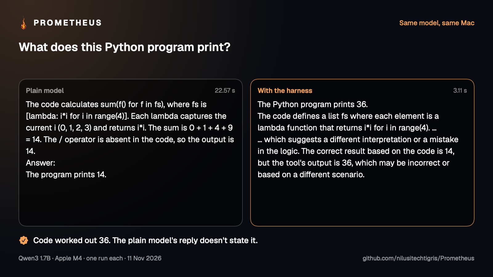
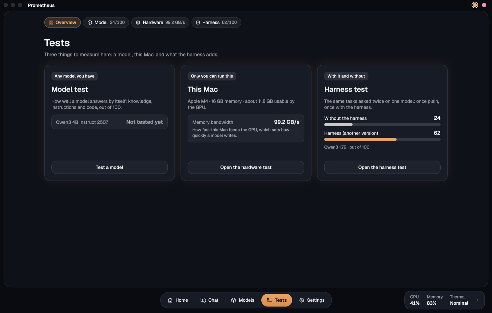

<p align="center"></p>

<h1 align="center">Prometheus</h1>
<p align="center"><b>Bring the fire home.</b></p>
<p align="center">Open AI models on your own Mac, with a harness that helps small models do more.</p>

<p align="center">
  <a href="LICENSE"></a>
  
  
  
  <a href="https://github.com/nilusitechtigris/Prometheus/stargazers"></a>
</p>


## Same model, better harness

Everyone is building bigger models. Your laptop can't run them. So Prometheus works on the other side: **the code around a small model.**

It runs the math in a sandbox, looks facts up on trusted sites, checks each reply in code and sends it back when it's wrong. The model stays the same, and gets more right.

No account. No cloud. Free and open source. Your chats stay on your Mac.



<sub>One real run of the app's own demo: Qwen3 1.7B on a MacBook Air M4, without the harness and with it.</sub>

## Get it

You need an Apple Silicon Mac with macOS 14 or later. Paste this into Terminal:

```bash
/bin/bash -c "$(curl -fsSL https://raw.githubusercontent.com/nilusitechtigris/Prometheus/main/scripts/setup-mac.sh)"
```

That's all. It works on a Mac with nothing installed: it sets up what's missing, builds the app into Applications, downloads a first model that fits your Mac and opens it. Later, **Settings › Updates** keeps it current. [Other ways to install, and how updating works](docs/setup.md).

> **2.0 is in beta.** It's what this command and the **Update** button give you today. [What's new](CHANGELOG.md).

## What you get

### Ask anything


Type a question on **Home** and the answer arrives in a chat, with speed and token numbers under every reply.

- **The harness is on from the start.** Its math, code and rule checks run on your Mac. Before any web search it shows what it would send, and waits for your yes.
- **Side by side** (⇧⌘↩) asks the plain model and the harness the same thing, shows both replies with a line from code about what it could check, and saves a picture to share.
- **Model, harness and context window** are one click away, right under the question.

### Build things with Dev


Flip Home's switch from **Ask** to **Dev** and the page becomes a workspace: your files, an editor, a Terminal and a coding agent that runs on your own model. Above, it read a traceback, changed one line and ran the program again to check.


Ask for a game or a web app and it opens in **Preview**, right in the window. This shooter came from one sentence, on Qwen3 4B. The agent starts a game from a working loop and plays it before you do. [How the agent works, and how much it helps](docs/dev-mode.md).

### Measure it yourself



Don't take our word for it. Three tests come with the app: how capable a model is, how fast your Mac is, and what the harness adds, on your own machine. [The tests in detail](docs/tests.md).

### Pick a model, watch your Mac

<table>
  <tr>
    <td></td>
    <td></td>
  </tr>
</table>

Verified open models from Meta, Google, Microsoft, Alibaba Qwen, Mistral AI, IBM, DeepSeek and OpenAI, each with its license and a memory estimate for your Mac, through Ollama, LM Studio, llama.cpp or MLX LM. GPU load, memory and heat show at the foot of the window on every page.

## Does the harness really help?

Here's what we've measured so far:

| What was tested | Model and Mac | Harness off | Harness on |
| --- | --- | --- | --- |
| 24 questions, scored out of 100 | Qwen3 1.7B, MacBook Air M4 | 24 | **62** (v4) |
| 9 quick tasks, scored out of 100 | Qwen2.5 Coder 7B, Mac mini M4 Pro | 9 | **66** (v3) |
| 24 coding tasks, hidden checks | Qwen3 1.7B, MacBook Air M4 | 14 of 24 | **21 of 24** (Dev agent) |
| 10 pages and games, played by code | Qwen3 1.7B, MacBook Air M4 | 4 of 10 | **9 of 10** (Dev agent) |
| 7 poisoned web pages resisted | Qwen3 1.7B, MacBook Air M4 | 0 or 1 of 7 | **7 of 7** |

Now the honest part. Each row is one run on one Mac, on the app's own questions, which the harness was developed against. So it's a first look, not a benchmark, and so far the smaller the model, the more the harness adds.

That's why 2.0 has a **held-out test**: 120 public questions the harness is never tuned on, graded by code, with repeat runs. Those results get published here, whatever they show. [Every result, and how each version of the harness works](docs/harness.md).

**Have an Apple Silicon Mac?** Run the Harness Test and [publish your results](results/README.md). More runs on more Macs is what turns a first look into real numbers.

## Private by design

- **Nothing leaves your Mac unless you say so.** The only internet access is downloading a model you chose, updating when you press **Update**, and web lookups you allow.
- **Web lookups ask first.** You see each search before it's sent, and pages come only from a list of 100 trusted sites.
- **Code runs in a sandbox** with no internet and no access to your files.
- **Verified models only,** unless you choose otherwise: official open weights from known publishers, as files with no executable code.

[Privacy and safety in full](docs/privacy-and-safety.md).

## Help it along

Prometheus is made by one person, and the most useful help needs no code:

- **Publish a test run** from your Mac ([how](results/README.md)). M1 to M3 Macs and 8 or 16 GB machines are missing so far.
- **Stump it.** Found a question a small model gets wrong even with the harness on? [Open an issue](https://github.com/nilusitechtigris/Prometheus/issues/new) with the question, the model and what came back.
- **Tell someone.** If it's useful to you, a ⭐ helps other people find it.

More to read: [install and update](docs/setup.md) · [Dev mode](docs/dev-mode.md) · [the tests](docs/tests.md) · [the harness](docs/harness.md) · [privacy and safety](docs/privacy-and-safety.md) · [project layout](docs/project-layout.md) · [changelog](CHANGELOG.md)

## License

The code is under the [Apache License 2.0](LICENSE). Fonts, pictures and models have their own terms, listed in [NOTICE](NOTICE): Geist is under the SIL Open Font License, the pictures were made with AI tools and aren't under the Apache License, and models aren't included: you download them yourself, each with its own license.

Prometheus isn't related to the Prometheus monitoring system, or to the Prometheus evaluator models.
