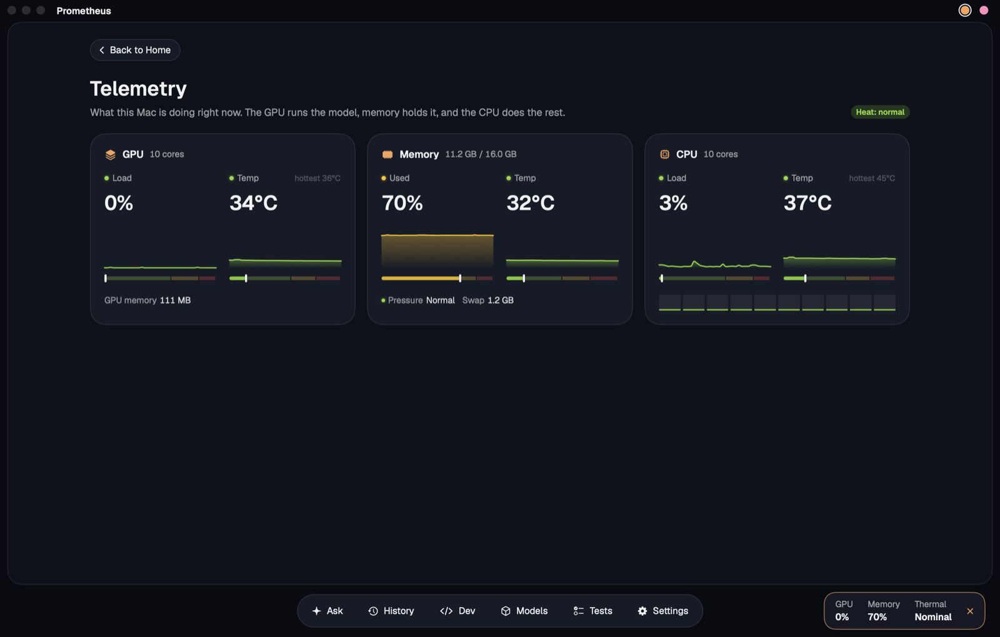
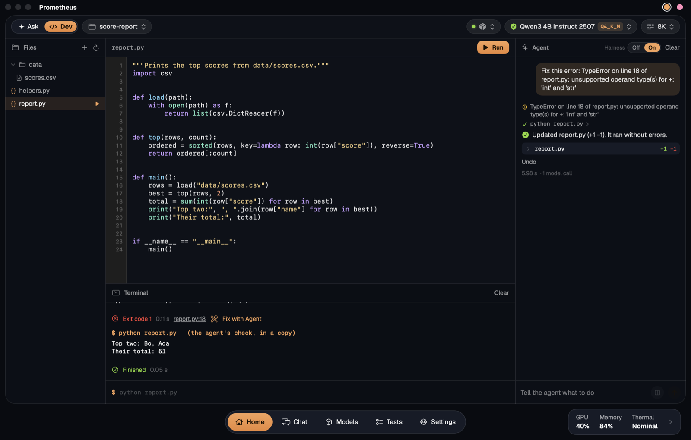
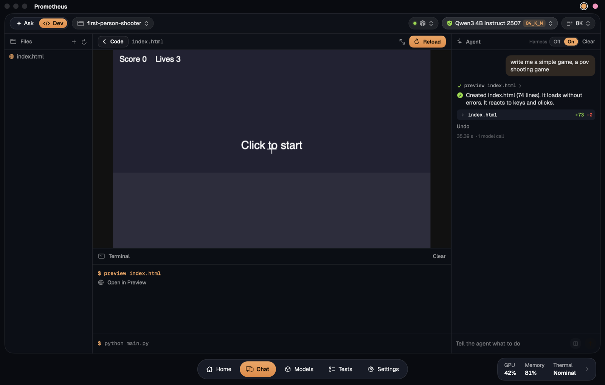

<p align="center"></p>

<h1 align="center">Prometheus</h1>
<p align="center"><b>Bring the fire home.</b></p>
<p align="center">A native Mac app for running open AI models on your own machine, with a harness that helps small models do more.</p>

<p align="center">
  <a href="LICENSE"></a>
  
  
  
  <a href="https://github.com/nilusitechtigris/Prometheus/stargazers"></a>
</p>

> **Version 2.0 is in beta.** It's what the install command and **Update** give you today, and it isn't tagged as a release yet. [What's new in 2.0](CHANGELOG.md). The pictures on this page are still from 1.0.


## Same model, better harness

Everyone is building bigger models. A laptop can't run them, so Prometheus works on the other side: the code around a small model. It runs the math in a sandbox, looks facts up on trusted sites, checks the reply in code and sends it back if it's wrong. The model stays the same, and does more.

| What was tested | Model and Mac | Harness off | Harness on |
| --- | --- | --- | --- |
| 24 questions, scored out of 100 | Qwen3 1.7B, MacBook Air M4 | 24 | **62** (v4) |
| 9 quick tasks, scored out of 100 | Qwen2.5 Coder 7B, Mac mini M4 Pro | 9 | **66** (v3) |
| 24 coding tasks, hidden checks | Qwen3 1.7B, MacBook Air M4 | 14 of 24 | **21 of 24** (Dev agent) |
| 10 pages and games, played by code | Qwen3 1.7B, MacBook Air M4 | 4 of 10 | **9 of 10** (Dev agent) |
| 7 poisoned web pages resisted | Qwen3 1.7B, MacBook Air M4 | 0 or 1 of 7 | **7 of 7** |

Each row is one run on one Mac, on the app's own test questions, which the harness was developed against. So treat it as a first look, not a benchmark. The details are [further down](#results-so-far).

Version 2.0 adds a **held-out test**: 120 public questions the harness is never tuned on, graded by code, with repeat runs. No held-out results are in yet. When they are, they go here, whatever they show.

**Have an Apple Silicon Mac?** Run the Harness Test and [publish your results](results/README.md): more runs on more Macs and models is what turns these into real numbers.

## What it is

Prometheus runs open models such as Qwen, Llama and Gemma on your Mac, through Ollama, LM Studio, llama.cpp or MLX LM. There's no account and no cloud service, and your chats stay on your Mac.

Small models are fast and private, but they get arithmetic wrong, misremember facts and break rules like "exactly three words". The **harness** is a layer of code around the model that helps with this. It runs math and code in a sandbox, checks replies in code before you see them, and can look facts up on trusted sites. A new install starts with it on. Its math, code and rule checks stay on your Mac. Before any web search it shows you what it will send and where, and waits for your yes. You can switch it off under the message box at any time.

**Side by side** asks the plain model and the harness the same question and shows both replies next to each other, with a line from code about what it could check, and a picture of the result you can save and share. The empty chat page has a three-question demo of it.

**Dev mode** turns the chat into a workspace for web apps and Python: open or start a project, and a coding agent writes, runs and fixes code in it, with a Terminal and a live Preview in the window. **Compare** builds the same request with the agent's harness off and on, side by side, to show what it adds.

The app also measures all of this for you: how capable a model is, how fast your Mac is, and how much each version of the harness really helps.

## Start it

You'll need an Apple Silicon Mac with macOS 14 or later. There's no prebuilt download yet, so you build it yourself.

### On a new Mac

Paste this into Terminal. It works on a Mac with nothing installed:

```bash
/bin/bash -c "$(curl -fsSL https://raw.githubusercontent.com/nilusitechtigris/Prometheus/main/scripts/setup-mac.sh)"
```

It asks for your password once, then installs whatever's missing: the Command Line Tools, Homebrew, Ollama and Node. It puts the code in `~/Prometheus`, builds the app into your Applications folder, downloads a first model that fits your Mac and opens the app.

It's safe to run again, because it skips what's already done. To see what it would do first, or to change the folder or skip the model, add `-- --dry-run` or `-- --help` to the end of the command. To install MLX LM as well, add `-- --mlx`.

### By hand

You'll need Xcode or the Command Line Tools (`xcode-select --install`).

**1. Build and open the app**

```bash
git clone https://github.com/nilusitechtigris/Prometheus.git
```

```bash
cd Prometheus && make run
```

To keep a copy in your Applications folder, run this as well:

```bash
make install
```

**2. Get a framework.** Ollama is the easiest, and the app walks you through it. If Ollama isn't on your Mac, the chat page has a **Get Ollama** button. It opens Ollama's own download page, and the app carries on by itself once Ollama is running. If Ollama is installed but not running, there's a **Start Ollama** button.

To do it in Terminal instead:

```bash
brew install ollama && brew services start ollama
```

To run MLX models as well, install MLX LM, then pick it in **Settings › Frameworks**. The app starts and stops it for you:

```bash
brew install mlx-lm
```

The harness runs JavaScript with Node, so install that too if you'll use it:

```bash
brew install node
```

**3. Download a model.** With no model yet, the chat page offers a starter picked for your Mac's memory, with one button. On 16 GB that's Qwen3 4B Instruct 2507. **Models** in the dock at the foot of the window has the rest, and shows which ones fit your Mac.

**4. Chat.** Open **Chat** and send a message, or press **See the harness at work** for the three-question demo. The **Harness** button under the message box turns the harness off and on.

### Updating

Open **Settings › Updates** and press **Update**. The app downloads the newest code from GitHub, builds it and restarts itself. You can keep using it during the build, and it waits for a running test, reply or download before it restarts. If anything goes wrong, your copy keeps working.

Before a new build first opens your saved data, it copies your chats, test history, Dev mode's chats and comparisons, and shared notes into a `Backups` folder beside them, and keeps the newest five copies.

It keeps the code in `~/Prometheus`, the same place the new Mac command uses, and it needs the Command Line Tools. It only ever moves forward, because an older build can erase saved chats it can't read. So it won't touch a copy built from code that isn't on `main`, or a `~/Prometheus` folder with changes of its own.

If your copy doesn't have the Updates tab yet, quit the app and paste this into Terminal:

```bash
/bin/bash -c "$(curl -fsSL https://raw.githubusercontent.com/nilusitechtigris/Prometheus/main/scripts/update-app.sh)"
```

## What's inside

### Chat


- Streaming replies with Markdown, code blocks, tables and collapsible thinking
- Stop, regenerate, and saved chats with search (⌘F). Select several chats to delete them together
- Speed, time and token numbers under every reply
- **Side by side** (⇧⌘↩): the plain model and the harness answer the same message next to each other, and one click saves a picture of it
- With the harness on, a card shows each web search before it's sent: **Allow once**, **Always allow** or **Not now**
- Framework, model and quantization, context window, Think, Harness and temperature under the message box

### Telemetry



GPU load, memory and heat show at the foot of the window on every page. Click them, or press ⌥⌘1, for the Telemetry page: load and temperature of the GPU, memory and CPU over the last minutes, with no admin rights needed. **Back**, Esc or ⌥⌘1 again returns to the page you were on, as you left it.

### Dev mode



Press **Dev** (`</>`) under the message box, then start a **New Project** or open a folder. The window becomes a workspace, with a coding agent that runs on your own model:

- **Files:** hover over a Python file and press ▶ to run it.
- **Editor:** line numbers, Python colours, find (⌘F), save (⌘S) and run (⌘R).
- **Terminal:** shows what a program prints. Type into it when a program asks for input, press Stop, or type a command like `python main.py 5`. After an error, click the file and line to jump there, or press **Fix with Agent**.
- **Preview:** games, charts and web pages run here, with real graphics, keyboard and mouse. Ask for one and it opens by itself. Any errors show up in the Terminal, ready for **Fix with Agent**.
- **Agent:** tell it what to build or change, or ask about the code. It shows each step and each file it changed, with **Undo** for every reply.
- **Harness Off / On,** above the agent. Off, the model gets one go at your request, and every file in its reply is saved as it came, with nothing run or checked. That's what using the model in a plain chat gives you. On is the agent described below. A second version, the checked build, builds and fixes the same way, then checks what a first use of the app would show. It tries one fix for each thing it finds, keeps the fix only if it holds, and says what it couldn't fix. It's new and has no scores yet, so it's only in the lab edition (see [The harness](#the-harness)).
- **Compare** (⧉ beside Send, or the Compare page): builds a request twice on the same model, in two new folders under Documents › Prometheus Projects › Comparisons, first with the harness off and then on. Both apps run side by side, each with its time, its number of model calls and the same scorecard, checked by code: does it show something, open without errors, look styled, work offline, work when used and fit the window. Earlier comparisons stay in a list, and either side opens as a project. Prompts made for testing it, with what each one tests, are in [docs/dev-mode-test-prompts.md](docs/dev-mode-test-prompts.md) and in the Compare page's **Prompts** menu.

The agent is made for small models, which lose track when they drive a long loop of tools by themselves. So code runs the loop, and the model gets one small job at a time, with only what that job needs:

- **Code picks the file** and reads the traceback. In a long file the model only sees the function that matters.
- **Code fits the reply in.** Small models often send back only what changed, or leave a comment standing in for the rest. The reply is merged by function, using Python's own parser, so the rest of the file survives.
- **Code fixes what it can:** a missing import, a `main()` nobody calls, tabs. A rename is done by code in every file, with no model at all.
- **A stuck model gets a smaller job.** Shown a whole file and asked to fix it, a small model often types it back unchanged. So a second try asks for the cause in plain words, then for a rewrite of just that function.
- **It runs and checks everything.** It runs the program and any tests, reads the error, fixes it and tries again. If your request spells out commands such as `python todo.py add milk`, it tries those too, and a program you asked to print something has to print it.
- **The report comes from code,** from what really happened, so it can't claim something worked when it didn't.

Nothing reaches your project until the agent finishes, and it tests in a throwaway copy, so code it wrote can't damage your files. Stop leaves everything as it was. Unless you pressed **Fix with Agent** on a failure, code you already have is only replaced by code that runs. The agent never runs anything in your real folder: that only happens when you press Run.



**Web apps.** Asked for a whole app in one reply, a small model forgets half the features, invents its styling as it goes, and links Bootstrap from the internet, which isn't there. By the time it writes the script, it has also lost track of the ids it gave the page. So the agent builds an app a file at a time:

- **A plan first:** the app's name, its parts, its data and what the user can do, in four short lines.
- **A style kit:** `kit.css` answers to Bootstrap's class names, which small models already know, with a cleaner look of its own, and works offline. The model writes the page's markup in those classes, and code writes the `<head>`, so the page is always linked to `kit.css`, `styles.css` and `app.js`.
- **A script against the real page:** `app.js` is written from a skeleton that keeps all data in one place and draws the page from it, and the model is shown the page's actual elements and ids.
- **Code checks how the files fit** before anything runs: a script that won't parse, an id the page doesn't have, a button calling a function it can't reach. A near miss such as `#taskInput` for `#task-input` is matched by code, with no model call.
- **Then it uses the app:** it fills in every field, sends each form and presses the buttons, and sends the app back if nothing on the page changed.

A change to an app with its own files goes to the files it needs, and each one hears what the others use, so a rewritten page keeps the ids the script looks up. A long script is edited a function at a time, as long Python files are.

Anything else you ask to see or play is written as a web page too, since macOS has a browser engine built in and nothing needs installing. The agent starts a game from a working loop, then plays it before you do: it presses keys, clicks around, and sends it back if there's an error, or if nothing moves. A first-person shooter starts from a ready-made one that draws, shoots and counts lives, so even a 1.7B model gets a playable game, and the model decides how the enemies move. It waits for your click, so it hasn't been lost by the time you look at it.

Python programs use the standard library and show text only, since they run in the sandbox. To get a text game instead, say so: "a text game in Python".

**How much it helps.** 24 coding tasks, each graded by checks the model never saw: new programs, edits, crashes to fix, a long file, tests, and two steps in a row. Think was off. "One reply" is the same model with one try and no harness. Each number is one run on a MacBook Air M4, so treat small gaps as noise.

| Model | Dev agent | One reply |
| --- | --- | --- |
| Qwen3 1.7B, Ollama | 21 of 24, 83 s | 14 of 24, 164 s |
| Qwen3 4B Instruct, Ollama | 22 of 24, 204 s | 19 of 24, 337 s |
| Qwen3 1.7B 4-bit, MLX LM | 17 of 24, 128 s | 13 of 24, 115 s |

It keeps the same 21 of 24 on the 1.7B model in a 4K context window. The agent can be faster than one reply because it doesn't retype a long file to change one function. Two text game tasks came later and aren't in these numbers.

**Pages and games.** Ten more tasks ask for something to look at: six small games (a first-person shooter, Pong, Snake, Breakout, a clicker and a memory game) and four pages (a drawing app, a bar chart, a bakery site and a calculator). Each one is graded by opening it out of sight and playing it. It has to load without errors and without asking for anything from the internet, and a game has to react to keys or clicks.

| Model | Dev agent | One reply |
| --- | --- | --- |
| Qwen3 1.7B, Ollama | 9 of 10, 517 s | 4 of 10, 232 s |
| Qwen3 4B Instruct, Ollama | 10 of 10, 572 s | 7 of 10, 907 s |
| Qwen3 8B, Ollama, 4K context | 9 of 10, 1234 s | 6 of 10, 704 s |

One reply mostly fails on things the agent fixes as it plays the page: a name that was never defined, a chart library or a picture from the internet, a game that never listens to the keyboard. Passing means it works, not that it's a good game, and small models make simple ones. The grading check was fixed after these runs (it missed small sprites on a big canvas), and the same pages were graded again with it. The ready-made shooter, and the repair for a canvas size the model garbles, came after these runs too.

**Web apps** are twelve more tasks, such as a todo list, an expense tracker, a kanban board, a quiz and a timer. Each one is graded by using it out of sight, and one that keeps a list has to show what was typed into it, which is more than the agent checks for itself. Their one reply is saved file by file, as with the harness off. These tasks are new, so there are no scores for them yet.

What it can't always catch is a program that runs cleanly and does the wrong thing, unless a test or a spelled-out command shows it. A game gets played with its own commands, and goes back if nothing changes as you play. Asking the model to review its own results was tried and left out: it took four times as long and scored no better. The tasks are in [scripts/dev_tasks.py](scripts/dev_tasks.py).

### Models


Verified open models from Meta, Google, Microsoft, Alibaba Qwen, Mistral AI, IBM, DeepSeek and OpenAI, with each one's license and a memory estimate for your Mac. With Ollama or MLX LM, you can download, use and remove them in one click, and switch between quantizations of a model. See who made the quantized file (⇧⌘M).

### Tests

The Tests page opens on an overview with one card for each test and its last result. All of them are laid out the same way:

- **Model Test** (⌥⌘3): 24 auto-graded questions across math, reasoning, knowledge, instructions, code and long context. Each topic has four levels worth 1, 2, 4 and 8 points. A score of 100 is the level of Claude Opus 5.5 at max effort, from a blind run of the same questions.
- **Hardware Test** (⌥⌘4, about 30 seconds): CPU, GPU, memory bandwidth and disk speed, plus 15 seconds of sustained GPU load to check for throttling.
- **Harness Test** (⌥⌘5) comes in four sizes, and scores from different sizes don't compare.
  - **Normal** is a quick check: 9 tasks across Coding, Knowledge and Instructions, which show the code sandbox, web search and the rule checks at work.
  - **Max** is the app's full test: the same 24 questions with the harness off and on, then 7 poisoned web pages both ways.
  - **Held-out** asks 120 public questions, from GSM8K, GSM-Plus, IFEval and MBPP, that the harness is never tuned on. Code grades every one, and the app shows totals without showing the questions or replies.
  - **Practice** asks 60 more of the same kinds. That's where failures get studied, so a gain there proves nothing.

  Choose **3 runs** to repeat a test and see every round's score, the mean and the spread. For any two runs on the same questions, the page counts the answers that flipped each way and says how often chance alone would split them that unevenly. **By route** shows, for each kind of task, how many questions went right with the harness and without, and how many flipped each way. Turn off **Harness off too** to run with the harness on only. How the public questions were picked, their licences and what a score on them can't show are in [benchmarks/heldout](benchmarks/heldout/README.md).

**Publish** (⌥⌘6, in the lab edition, see [The harness](#the-harness)) shares your results. Tick the runs you want and press **Publish**. The app saves a JSON file and a readable report named after your Mac and the date, then opens GitHub, where you drag them in to make a pull request. Each task shows its reply, the end of the model's thinking, its token counts, time and points. People's results are in [results](results/README.md), which also describes the files.

## The harness

**Harness on** means v3, the loop. In the one published run where every version shared a setup it scored highest, level with v4, and it's the simplest of the versions that check a reply and try again. The app runs that one, and there's nothing to choose.

Every other version stays in the code, so the results below can be repeated. One line in Terminal turns a copy into the **lab edition**, which adds **Other versions** to the Harness button in chat, a version to pick in the Harness Test, the Versions tab, Publish on the Tests page, and v1 and v2 in Dev mode:

```sh
defaults write com.localaiagent.app edition lab
```

Quit and open the app again after it. `defaults delete com.localaiagent.app edition` turns it back. Your chats and test runs are the same in both.

| Version | What it does |
| --- | --- |
| **v1 Model tools** | The model gets the tools and decides when to call them. |
| **v2 Pipeline** | The harness works out what the task needs and runs one tool, then the model answers from what it found. Kept exactly as it was. |
| **v3 Loop** | The pipeline, plus code that checks each reply and goes round again until it passes. |
| **v4 Thinking loop** | The loop, with the model thinking through every step it takes part in. Needs Think on: with it off, it works like v3. |
| **v5 Council** | Code prepares a shared notes file, then three agents with their own personality and temperature discuss the task in it, thinking on. |
| **v6 Evidence loop** | New in 2.0, and not scored yet. The loop with stricter evidence: code works out dates, letter counts and sums itself, a looked-up answer only counts when one sentence on the page holds it, and its steps end by saying what was checked. Two rounds at most. |
| **v7 One harness** | New, lab edition only, and not scored yet. It sends each task down one route and switches on only what that route needs: nothing at all, exact code, a program beside the model's own answer, the reply's own code run on the examples in the message, a lookup only when the model isn't sure, a long text's passages, or rule checks. Every route starts from the plain model's reply where it can. |


In the lab edition, the Versions tab puts them side by side, question by question, for runs on the same model and setup:


### Results so far

None of these are held-out results. They come from the app's own questions, which the harness was developed against, and each is a single run. v6 isn't in them: it has no test runs yet.

**Max test** (24 questions), scores out of 100, with thinking on, on a MacBook Air M4:

| Model | Context | Off | v1 | v2 | v3 | v4 | v5 |
| --- | --- | --- | --- | --- | --- | --- | --- |
| Qwen3 1.7B Q4_K_M | 4K | 24 | 25 | 42 | not run | not run | not run |
| Qwen3 1.7B FP16 | 8K | 28 | not run | not run | 48 | not run | not run |
| Qwen3 1.7B Q4_K_M | 8K | 24 | not run | not run | not run | 62 | not run |

These are single runs, so don't read much into small differences, and the rows use different setups. They also come from an older version of the test, which gave thinking less room on easy questions and marked a few right answers wrong, so new runs won't compare with them. The v3 run came before a calculator fix that affected one 4-point question. Injection protection stopped 7 of 7 poisoned pages in these runs, against 1 of 7 at most without it.

**Normal test** (9 tasks), scores out of 100, with thinking off, on a Mac mini M4 Pro with 24 GB, from the current version of the test. It's [published in full](results/mac-mini-m4-pro-24gb-2026-11-07-1228.md), with every reply:

| Model | Context | Off | v1 | v2 | v3 | v4 | v5 |
| --- | --- | --- | --- | --- | --- | --- | --- |
| Qwen2.5 Coder 7B Q8_0 | 16K | 9 | 9 | 47 | 66 | 66 | 47 |

With thinking off, v4 works like v3, so their scores match. In v1 the model wrote its tool calls as plain text instead of making them, then answered anyway: it called element 74 plutonium (it's tungsten). Normal and Max scores don't compare with each other.

### How v3 works

1. **Understand**: works out what kind of task this is.
2. **Act**: runs the right tool. A math or code task runs in the sandbox, a fact is looked up, and a long text is cut down to the passages that matter.
3. **Answer**: the model replies with that evidence in front of it.
4. **Check**: code tests the reply. Was it cut off? Does it state the tool's result? Is the answer in the sources? Does it break a rule such as a word count? If it fails, it goes back to Act with what it learned.

It stops when a reply passes, when a round changes nothing, or at the rounds set in Settings › Safety, and it keeps the best attempt so far. It only ever sees the question, never the expected answer.

### What v4 adds

v3 turns thinking off at almost every step, to save tokens. v4 leaves it on. With Think on, the model reasons before it classifies a task, picks a search, writes a program, answers or rewrites a sentence, and it sees what Check found wrong when it goes round again.

Each step gets extra tokens for this, a quarter of the context up to 2,048. If thinking uses them all, that step goes again without thinking, so a step can't end up with less than it would have had in v3. Check stays code, and anything plain code can settle, such as a simple sum, doesn't call the model at all. It takes longer than v3, and with Think off the two work the same.

### How v5 works

Three agents discuss the task in a Markdown file. They're the same model taking turns, so they use the memory of one and the time of several.

| Agent | Temperature | Personality |
| --- | --- | --- |
| **Solver** | 0.2 | Works step by step and relies on what it can show |
| **Skeptic** | 0.5 | Looks for the flaw and tests answers on a small case |
| **Explorer** | 0.8 | Tries another route and questions what the others assume |

1. **Prepare**: code writes the file, with the task, the chat so far and what the tools found, the same way v3 does.
2. **Round 1**: each agent answers on its own. Nobody sees the others' notes yet, so they don't all copy whoever went first.
3. **Later rounds**: each agent reads the file and answers the others. Code adds what it can check, such as a broken word count or a result the tools disagree with. An agent can only change its answer by giving a reason, because small models tend to copy whoever they read last. Otherwise its old answer stands.
4. **Decide**: after each round, code compares their answers. It stops when all three agree, when nobody changes their answer, or at the rounds set in Settings › Safety. Two out of three is enough at the end.
5. **Reply**: an agent that holds the group's answer writes the reply, and v3's checks test it. A result from the tools outranks anything the agents settled on. On writing tasks, a draft that passes the checks is the reply.

Code does all the reading and writing, so a small model needs no file tools and a bad reply can't damage the file. When the file outgrows the context, an agent is handed the newest rounds that fit. Thinking stays on whatever the Think button says, and an agent that thinks until its tokens run out finishes from where its thinking stopped, so the reasoning isn't lost.

The file builds up under **Shared notes** above the reply, with a button to find it in Finder. It's kept in the app's data folder and goes when you delete the chat.

### Can the models call tools themselves?

Yes. All six Qwen3 models tried so far (1.7B, 4B and 8B, in several quantizations) produce real tool calls, in 34 of 44 prompts in a short check, and all of them used a calculator result correctly. All 10 misses had thinking on and ran out of tokens before making a call, so try v1 with Think off. Being able to call a tool doesn't make the reply right, though: the 1.7B models sometimes search the web for arithmetic, or search for a fact and still get it wrong. That's why v2 onwards don't leave it to the model.

## Privacy and safety

- **Harness off:** the only internet access is downloading models you choose, through your framework, and updating the app when you press **Update**. It never checks for updates by itself. The app runs MLX LM offline, so it only reaches Hugging Face when you download a model.
- **Harness on:** math, code and rule checks run on your Mac. Before a web search, the app shows the search and where it goes, and waits for your answer: allow once, always allow, or not now. **Settings › Harness** sets it to ask first, always or never. When you allow it, search terms go to Wikipedia, Stack Overflow, arXiv and MDN, and pages come only from a list of 100 trusted sites. Every search and page is listed above the reply. The Harness Test asks once before it starts, because it can't stop to ask for each lookup.
- **Publishing:** the app sends nothing itself. The file holds the runs you chose and your Mac's kind, chip, core counts, memory and macOS version, but never your chats, your name, your computer's name or its serial number. It only goes online if you paste it into GitHub and submit it, and it's public once you do.
- **Code** runs in a deny-by-default macOS sandbox with no internet, no other programs and no access to your files, limited to 10 seconds, 1 GB of memory and 10 MB of files.
- **Dev mode** stays on this Mac: your code only goes to the model running here. The agent can only touch files inside the folder you opened. It tests in a copy of the folder that leaves out hidden files such as `.env`, for up to 15 seconds a run. Programs you start in the Terminal run in the folder itself, so they can change its files, but the same sandbox keeps them from the internet, other programs and everything outside it, for up to 10 minutes and 2 GB of memory. They can't write hidden files either, so a program can't plant a Git hook that would later run outside the sandbox. The agent and a program in the Terminal take turns, so nothing changes the folder while the agent saves.
- **Preview** is held tighter still. A page sees the project's own files, read-only, and can't change anything on disk. Nothing leaves the view: WebRTC is switched off in the engine, a rule list and the page's own policy block connections, links and page changes are stopped, and in case something gets past those, its web traffic goes to a proxy that doesn't exist. The app checks that WebRTC really is off before it opens any page, and refuses if not. That setting isn't a public macOS one, so an update could change it. Local addresses skip the proxy, so a page could at most reach something on this Mac if it got past everything else. Its storage is thrown away when it closes, it can't open windows, and it has no camera or microphone.
- **Prompt injection:** hidden text and text aimed at the assistant are removed before the model reads a page, and links to untrusted sites are removed from its replies. This is basic protection: it blocks common attacks, not every possible one.
- **Tools in chat:** from v2 on only the harness uses them, so a web page can't steer one. In v5, once the web has been read, each agent's note gets the same cleaning as a page before the others read it. In v1 the model holds them, so once it has read the web it can't search again and can only open links it was given.
- **Models:** The catalog (`Sources/LocalAIAgent/Models/ModelCatalog.swift`) only lists official open-weight models from Meta, Google, Microsoft, Alibaba Qwen, Mistral AI, IBM, DeepSeek and OpenAI. These are widely used models, and the app verified each Ollama tag against the registry. They download as GGUF files: tensors only, no executable code, checksum-verified. MLX versions come from the mlx-community project on Hugging Face, as safetensors files with no code in them: Phi-4 Mini is left out because its MLX version has code files. Models outside the catalog are disabled unless you turn on **Settings › Safety › Allow unverified models**.

The harness needs Ollama or MLX LM, and a model that supports tools for v1.

## Project layout

```
assets/art/                 AI-generated pictures; originals/ holds the unedited exports
assets/fonts/               Geist and Geist Mono (SIL Open Font License)
benchmarks/heldout/         The held-out and practice questions, their licences and the rules for using them
docs/screenshots/           The pictures in this file
Sources/SensorsC/           C bridge: Apple SMC + HID temperature sensors
Sources/LocalAIAgent/
  App/                      App entry, settings, debug hooks
  Backends/                 Ollama + OpenAI-compatible clients (streaming)
  Services/                 Backend/chat controllers, persistence, model + hardware tests
  Services/Harness/         The harness versions, shared notes, trusted sites, web tools, calculator, injection guard and test
  Services/Dev/             Dev mode: project files, sandboxed runs, Python and JavaScript parsing, the coding agent, the web app builder and its style kit, comparisons, and the checks
  Telemetry/                CPU/GPU/memory/thermal sampling
  Models/                   Chat types, curated catalog, health thresholds
  Views/                    Forge layout and chats, chat, telemetry widgets, test dashboards, library, settings
results/                    Test results people have published, and the file format
scripts/build-app.sh        Builds and ad-hoc signs the .app bundle
scripts/dev_tasks.py        The coding tasks Dev mode's agent is measured on
scripts/heldout/sample.py   Draws the held-out and practice questions from their public sources, the same way every time
scripts/setup-mac.sh        Takes a new Mac from nothing to the running app
scripts/update-app.sh       Updates the app to the newest code; the Update button runs this too
```

Conversations are stored in `~/Library/Application Support/LocalAIAgent/conversations.json`. Copies made before a new build opens them are in `Backups` in the same folder.

> **Note:** The macOS 27 SDK in Command Line Tools declares SwiftUI's `@State` as a macro whose plugin only ships with Xcode. `build-app.sh` detects this and builds against the newest installed SDK that doesn't need the macro (26.5 here).

## Help it along

Prometheus is made by one person, and the most useful help needs no code:

- **Publish a test run.** Run the Harness Test on your Mac, then press **Publish**, which is in the lab edition ([how](results/README.md)). A **Held-out** run with **3 runs** is the most useful one now. Any Apple Silicon Mac and any model helps, and M1 to M3 Macs and 8 or 16 GB machines are missing so far.
- **Stump it.** Found a question that a small model gets wrong even with the harness on? [Open an issue](https://github.com/nilusitechtigris/Prometheus/issues/new) with the question, the model and what came back. Failures are how each version of the harness was made.
- **Tell someone.** If it's useful to you, a ⭐ helps other people find it.

## License

The code is licensed under the [Apache License 2.0](LICENSE). A few things in this repository have their own terms, listed in [NOTICE](NOTICE):

- **Fonts:** Geist and Geist Mono are under the [SIL Open Font License](assets/fonts/OFL.txt).
- **Pictures:** the backgrounds and the icon were made with Canva's AI tools. They aren't under the Apache License, and Canva's [AI Product Terms](https://www.canva.com/policies/ai-product-terms/) apply to them.
- **Models:** none are included. You download them yourself, and each has its own license, shown in the Model Library.

Prometheus isn't related to the Prometheus monitoring system, or to the Prometheus evaluator models.
