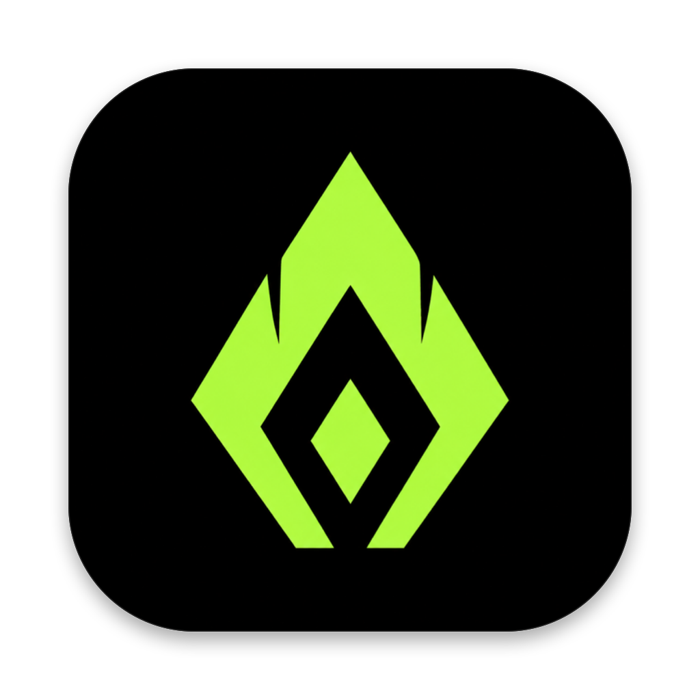
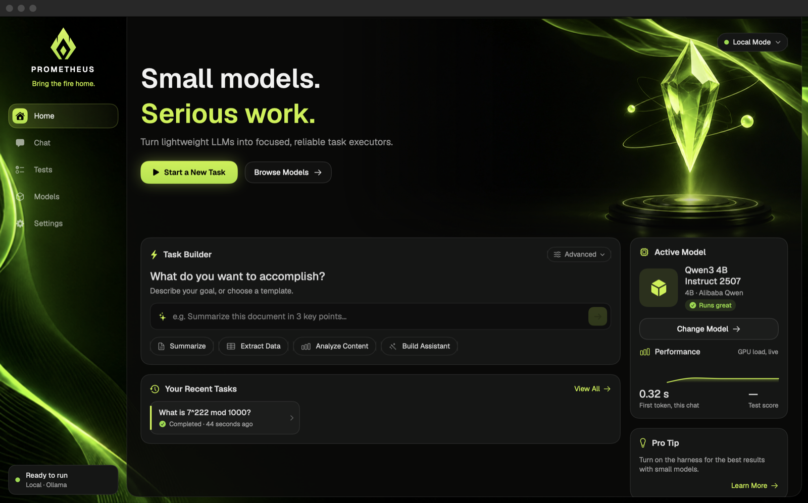
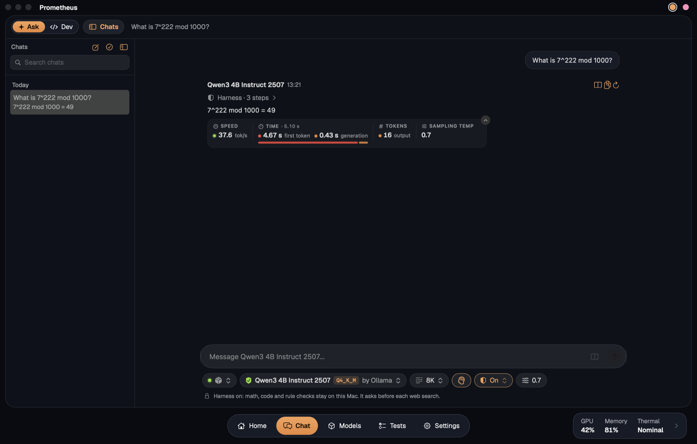
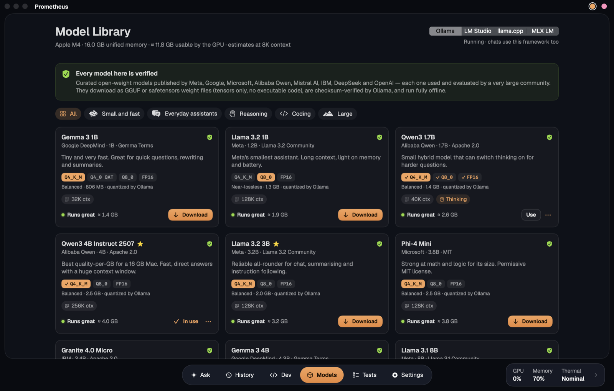
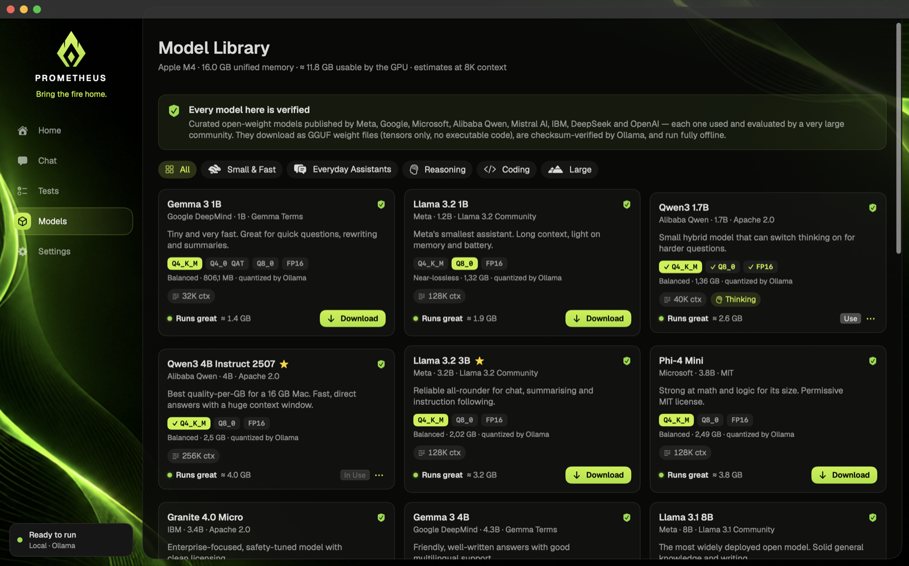
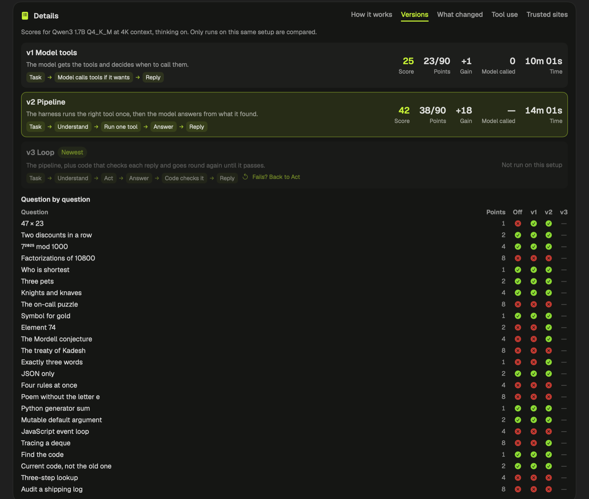

<p align="center"></p>

<h1 align="center">Prometheus</h1>
<p align="center"><b>Bring the fire home.</b></p>
<p align="center">A native Mac app for running open AI models on your own machine, with a harness that helps small models do more.</p>



## What it is

Prometheus runs open models such as Qwen, Llama and Gemma on your Mac, through Ollama, LM Studio, llama.cpp or MLX LM. There's no account and no cloud service, and your chats stay on your Mac.

Small models are fast and private, but they get arithmetic wrong, misremember facts and break rules like "exactly three words". The **harness** is an optional layer that helps with this. It can run code in a sandbox, search trusted sites, and check replies in code before you see them. It's off by default, because its searches leave your Mac.

The app also measures all of this for you: how capable a model is, how fast your Mac is, and how much each version of the harness really helps.

## Start it

You'll need an Apple Silicon Mac with macOS 14 or later. There's no prebuilt download yet, so you build it yourself.

### On a new Mac

Paste this into Terminal. It works on a Mac with nothing installed:

```bash
/bin/bash -c "$(curl -fsSL https://raw.githubusercontent.com/nilusitechtigris/Prometheus/main/scripts/setup-mac.sh)"
```

It asks for your password once, then installs whatever's missing: the Command Line Tools, Homebrew, Ollama and Node. It puts the code in `~/Prometheus`, builds the app into your Applications folder, downloads a first model that fits your Mac and opens the app.

It's safe to run again, because it skips what's already done. To see what it would do first, or to change the folder or skip the model, add `-- --dry-run` or `-- --help` to the end of the command. To install MLX LM as well, add `-- --mlx`.

### By hand

You'll need Xcode or the Command Line Tools (`xcode-select --install`).

**1. Build and open the app**

```bash
git clone https://github.com/nilusitechtigris/Prometheus.git
```

```bash
cd Prometheus && make run
```

To keep a copy in your Applications folder, run this as well:

```bash
make install
```

**2. Start a framework.** Ollama is the easiest:

```bash
brew install ollama && brew services start ollama
```

If Ollama is installed but not running, the app shows a **Start Ollama** button.

To run MLX models as well, install MLX LM, then pick it in **Settings › Frameworks**. The app starts and stops it for you:

```bash
brew install mlx-lm
```

The harness runs JavaScript with Node, so install that too if you'll use it:

```bash
brew install node
```

**3. Download a model.** Open **Models** in the sidebar and pick one. It shows which models fit your Mac. Qwen3 4B Instruct 2507 is a good first choice on 16 GB.

**4. Chat.** Open **Chat** and send a message. To try the harness, click the **Harness** button under the message box and pick a version.

### Updating

Open **Settings › Updates** and press **Update**. The app downloads the newest code from GitHub, builds it and restarts itself. You can keep using it during the build, and it waits for a running test, reply or download before it restarts. If anything goes wrong, your copy keeps working.

It keeps the code in `~/Prometheus`, the same place the new Mac command uses, and it needs the Command Line Tools. It only ever moves forward, because an older build can erase saved chats it can't read. So it won't touch a copy built from code that isn't on `main`, or a `~/Prometheus` folder with changes of its own.

If your copy doesn't have the Updates tab yet, quit the app and paste this into Terminal:

```bash
/bin/bash -c "$(curl -fsSL https://raw.githubusercontent.com/nilusitechtigris/Prometheus/main/scripts/update-app.sh)"
```

## What's inside

### Chat



- Streaming replies with Markdown, code blocks, tables and collapsible thinking
- Stop, regenerate, and saved chats with search (⌘F). Select several chats to delete them together
- Speed, time and token numbers under every reply
- Framework, model and quantization, context window, Think, Harness and temperature under the message box
- Live hardware telemetry along the bottom (⌥⌘1): GPU, memory and CPU load and temperatures, with no admin rights needed

### Models



Verified open models from Meta, Google, Microsoft, Alibaba Qwen, Mistral AI, IBM, DeepSeek and OpenAI, with each one's license and a memory estimate for your Mac. With Ollama or MLX LM, you can download, use and remove them in one click, and switch between quantizations of a model. See who made the quantized file (⇧⌘M).

### Tests

One page with three tabs, all laid out the same way:

- **Model Test** (⌥⌘3): 24 auto-graded questions across math, reasoning, knowledge, instructions, code and long context. Each topic has four levels worth 1, 2, 4 and 8 points. A score of 100 is the level of Claude Opus 5.5 at max effort, from a blind run of the same questions.
- **Hardware Test** (⌥⌘4, about 30 seconds): CPU, GPU, memory bandwidth and disk speed, plus 15 seconds of sustained GPU load to check for throttling.
- **Harness Test** (⌥⌘5): the same 24 questions with the harness off and on, then 7 poisoned web pages both ways. Turn off **Harness off too** to run them with the harness on only.

**Publish** (⌥⌘6) shares your results. Tick the runs you want and press **Publish**. The app saves a JSON file named after your Mac and the date, then opens GitHub, where you drag the file in to make a pull request. People's results are in [results](results/README.md), which also describes the file.

## The harness

Every version stays available, in chat and in the Harness Test, so you can compare them on your own models.

| Version | What it does |
| --- | --- |
| **v1 Model tools** | The model gets the tools and decides when to call them. |
| **v2 Pipeline** | The harness works out what the task needs and runs one tool, then the model answers from what it found. Kept exactly as it was. |
| **v3 Loop** | The pipeline, plus code that checks each reply and goes round again until it passes. |
| **v4 Thinking loop** | The loop, with the model thinking through every step it takes part in. Needs Think on: with it off, it works like v3. |
| **v5 Council** | The newest. Code prepares a shared notes file, then three agents with their own personality and temperature discuss the task in it, thinking on. |



The Versions tab puts them side by side, question by question, for runs on the same model and setup:



### Results so far

Scores out of 100, with thinking on:

| Model | Context | Off | v1 | v2 | v3 | v4 | v5 |
| --- | --- | --- | --- | --- | --- | --- | --- |
| Qwen3 1.7B Q4_K_M | 4K | 24 | 25 | 42 | not run | not run | not run |
| Qwen3 1.7B FP16 | 8K | 28 | not run | not run | 48 | not run | not run |

These are single runs, so don't read much into small differences, and the two rows use different setups. They also come from an older version of the test, which gave thinking less room on easy questions and marked a few right answers wrong, so new runs won't compare with them. The v3 run came before a calculator fix that affected one 4-point question, and v4 and v5 haven't been scored yet. Injection protection stopped 7 of 7 poisoned pages in these runs, against 0 of 7 without it.

### How v3 works

1. **Understand**: works out what kind of task this is.
2. **Act**: runs the right tool. A math or code task runs in the sandbox, a fact is looked up, and a long text is cut down to the passages that matter.
3. **Answer**: the model replies with that evidence in front of it.
4. **Check**: code tests the reply. Was it cut off? Does it state the tool's result? Is the answer in the sources? Does it break a rule such as a word count? If it fails, it goes back to Act with what it learned.

It stops when a reply passes, when a round changes nothing, or at the rounds set in Settings › Safety, and it keeps the best attempt so far. It only ever sees the question, never the expected answer.

### What v4 adds

v3 turns thinking off at almost every step, to save tokens. v4 leaves it on. With Think on, the model reasons before it classifies a task, picks a search, writes a program, answers or rewrites a sentence, and it sees what Check found wrong when it goes round again.

Each step gets extra tokens for this, a quarter of the context up to 2,048. If thinking uses them all, that step goes again without thinking, so a step can't end up with less than it would have had in v3. Check stays code, and anything plain code can settle, such as a simple sum, doesn't call the model at all. It takes longer than v3, and with Think off the two work the same.

### How v5 works

Three agents discuss the task in a Markdown file. They're the same model taking turns, so they use the memory of one and the time of several.

| Agent | Temperature | Personality |
| --- | --- | --- |
| **Solver** | 0.2 | Works step by step and relies on what it can show |
| **Skeptic** | 0.5 | Looks for the flaw and tests answers on a small case |
| **Explorer** | 0.8 | Tries another route and questions what the others assume |

1. **Prepare**: code writes the file, with the task, the chat so far and what the tools found, the same way v3 does.
2. **Round 1**: each agent answers on its own. Nobody sees the others' notes yet, so they don't all copy whoever went first.
3. **Later rounds**: each agent reads the file and answers the others. Code adds what it can check, such as a broken word count or a result the tools disagree with. An agent can only change its answer by giving a reason, because small models tend to copy whoever they read last. Otherwise its old answer stands.
4. **Decide**: after each round, code compares their answers. It stops when all three agree, when nobody changes their answer, or at the rounds set in Settings › Safety. Two out of three is enough at the end.
5. **Reply**: an agent that holds the group's answer writes the reply, and v3's checks test it. A result from the tools outranks anything the agents settled on. On writing tasks, a draft that passes the checks is the reply.

Code does all the reading and writing, so a small model needs no file tools and a bad reply can't damage the file. When the file outgrows the context, an agent is handed the newest rounds that fit. Thinking stays on whatever the Think button says, and an agent that thinks until its tokens run out finishes from where its thinking stopped, so the reasoning isn't lost.

The file builds up under **Shared notes** above the reply, with a button to find it in Finder. It's kept in the app's data folder and goes when you delete the chat.

### Can the models call tools themselves?

Yes. All six Qwen3 models tried so far (1.7B, 4B and 8B, in several quantizations) produce real tool calls, in 34 of 44 prompts in a short check, and all of them used a calculator result correctly. All 10 misses had thinking on and ran out of tokens before making a call, so try v1 with Think off. Being able to call a tool doesn't make the reply right, though: the 1.7B models sometimes search the web for arithmetic, or search for a fact and still get it wrong. That's why v2 onwards don't leave it to the model.

## Privacy and safety

- **Harness off:** the only internet access is downloading models you choose, through your framework, and updating the app when you press **Update**. It never checks for updates by itself. The app runs MLX LM offline, so it only reaches Hugging Face when you download a model.
- **Harness on:** search terms go to Wikipedia, Stack Overflow, arXiv and MDN, and pages come only from a list of 100 trusted sites. Every search and page is listed above the reply.
- **Publishing:** the app sends nothing itself. The file holds the runs you chose and your Mac's kind, chip, core counts, memory and macOS version, but never your chats, your name, your computer's name or its serial number. It only goes online if you upload it to GitHub, and it's public once you do.
- **Code** runs in a deny-by-default macOS sandbox with no internet, no other programs and no access to your files, limited to 10 seconds, 1 GB of memory and 10 MB of files.
- **Prompt injection:** hidden text and text aimed at the assistant are removed before the model reads a page, and links to untrusted sites are removed from its replies. This is basic protection: it blocks common attacks, not every possible one.
- **Tools in chat:** from v2 on only the harness uses them, so a web page can't steer one. In v5, once the web has been read, each agent's note gets the same cleaning as a page before the others read it. In v1 the model holds them, so once it has read the web it can't search again and can only open links it was given.
- **Models:** The catalog (`Sources/LocalAIAgent/Models/ModelCatalog.swift`) only lists official open-weight models from Meta, Google, Microsoft, Alibaba Qwen, Mistral AI, IBM, DeepSeek and OpenAI. These are widely used models, and the app verified each Ollama tag against the registry. They download as GGUF files: tensors only, no executable code, checksum-verified. MLX versions come from the mlx-community project on Hugging Face, as safetensors files with no code in them: Phi-4 Mini is left out because its MLX version has code files. Models outside the catalog are disabled unless you turn on **Settings › Safety › Allow unverified models**.

The harness needs Ollama or MLX LM, and a model that supports tools for v1.

## Project layout

```
assets/art/                 AI-generated pictures; originals/ holds the unedited exports
assets/fonts/               Geist and Geist Mono (SIL Open Font License)
docs/screenshots/           The pictures in this file
Sources/SensorsC/           C bridge: Apple SMC + HID temperature sensors
Sources/LocalAIAgent/
  App/                      App entry, settings, debug hooks
  Backends/                 Ollama + OpenAI-compatible clients (streaming)
  Services/                 Backend/chat controllers, persistence, model + hardware tests
  Services/Harness/         The harness versions, shared notes, trusted sites, web tools, calculator, injection guard and test
  Telemetry/                CPU/GPU/memory/thermal sampling
  Models/                   Chat types, curated catalog, health thresholds
  Views/                    Forge layout and chats, chat, telemetry widgets, test dashboards, library, settings
results/                    Test results people have published, and the file format
scripts/build-app.sh        Builds and ad-hoc signs the .app bundle
scripts/setup-mac.sh        Takes a new Mac from nothing to the running app
scripts/update-app.sh       Updates the app to the newest code; the Update button runs this too
```

Conversations are stored in `~/Library/Application Support/LocalAIAgent/conversations.json`.

> **Note:** The macOS 27 SDK in Command Line Tools declares SwiftUI's `@State` as a macro whose plugin only ships with Xcode. `build-app.sh` detects this and builds against the newest installed SDK that doesn't need the macro (26.5 here).

## License

The code is licensed under the [Apache License 2.0](LICENSE). A few things in this repository have their own terms, listed in [NOTICE](NOTICE):

- **Fonts:** Geist and Geist Mono are under the [SIL Open Font License](assets/fonts/OFL.txt).
- **Pictures:** the backgrounds and the icon were made with Canva's AI tools. They aren't under the Apache License, and Canva's [AI Product Terms](https://www.canva.com/policies/ai-product-terms/) apply to them.
- **Models:** none are included. You download them yourself, and each has its own license, shown in the Model Library.

Prometheus isn't related to the Prometheus monitoring system.
