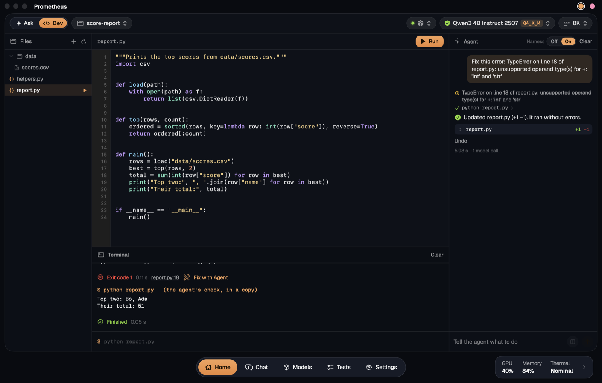
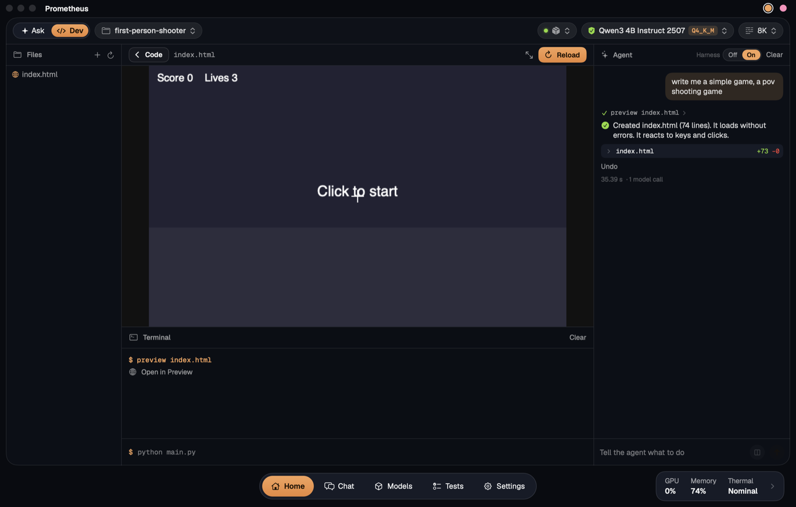

# Dev mode

On **Home**, flip the switch in the top left corner from **Ask** to **Dev** (or press ⇧⌘D), then start a **New Project** or open a folder. The page becomes a workspace, with a coding agent that runs on your own model:

- **Files:** hover over a Python file and press ▶ to run it.
- **Editor:** line numbers, Python colours, find (⌘F), save (⌘S) and run (⌘R).
- **Terminal:** shows what a program prints. Type into it when a program asks for input, press Stop, or type a command like `python main.py 5`. After an error, click the file and line to jump there, or press **Fix with Agent**.
- **Preview:** games, charts and web pages run here, with real graphics, keyboard and mouse. Ask for one and it opens by itself. Any errors show up in the Terminal, ready for **Fix with Agent**.
- **Agent:** tell it what to build or change, or ask about the code. It shows each step and each file it changed, with **Undo** for every reply.
- **Harness Off / On,** above the agent. Off, the model gets one go at your request, and every file in its reply is saved as it came, with nothing run or checked. That's what using the model in a plain chat gives you. On is the agent described below. A second version, the checked build, builds and fixes the same way, then checks what a first use of the app would show. It tries one fix for each thing it finds, keeps the fix only if it holds, and says what it couldn't fix. It's new and has no scores yet, so it's only in the lab edition (see [The harness](harness.md)).
- **Compare** (⧉ beside Send, or the Compare page): builds a request twice on the same model, in two new folders under Documents › Prometheus Projects › Comparisons, first with the harness off and then on. Both apps run side by side, each with its time, its number of model calls and the same scorecard, checked by code: does it show something, open without errors, look styled, work offline, work when used and fit the window. Earlier comparisons stay in a list, and either side opens as a project. Prompts made for testing it, with what each one tests, are in [docs/dev-mode-test-prompts.md](dev-mode-test-prompts.md) and in the Compare page's **Prompts** menu.

The agent is made for small models, which lose track when they drive a long loop of tools by themselves. So code runs the loop, and the model gets one small job at a time, with only what that job needs:

- **Code picks the file** and reads the traceback. In a long file the model only sees the function that matters.
- **Code fits the reply in.** Small models often send back only what changed, or leave a comment standing in for the rest. The reply is merged by function, using Python's own parser, so the rest of the file survives.
- **Code fixes what it can:** a missing import, a `main()` nobody calls, tabs. A rename is done by code in every file, with no model at all.
- **A stuck model gets a smaller job.** Shown a whole file and asked to fix it, a small model often types it back unchanged. So a second try asks for the cause in plain words, then for a rewrite of just that function.
- **It runs and checks everything.** It runs the program and any tests, reads the error, fixes it and tries again. If your request spells out commands such as `python todo.py add milk`, it tries those too, and a program you asked to print something has to print it.
- **The report comes from code,** from what really happened, so it can't claim something worked when it didn't.

Nothing reaches your project until the agent finishes, and it tests in a throwaway copy, so code it wrote can't damage your files. Stop leaves everything as it was. Unless you pressed **Fix with Agent** on a failure, code you already have is only replaced by code that runs. The agent never runs anything in your real folder: that only happens when you press Run.

**Web apps.** Asked for a whole app in one reply, a small model forgets half the features, invents its styling as it goes, and links Bootstrap from the internet, which isn't there. By the time it writes the script, it has also lost track of the ids it gave the page. So the agent builds an app a file at a time:

- **A plan first:** the app's name, its parts, its data and what the user can do, in four short lines.
- **A style kit:** `kit.css` answers to Bootstrap's class names, which small models already know, with a cleaner look of its own, and works offline. The model writes the page's markup in those classes, and code writes the `<head>`, so the page is always linked to `kit.css`, `styles.css` and `app.js`.
- **A script against the real page:** `app.js` is written from a skeleton that keeps all data in one place and draws the page from it, and the model is shown the page's actual elements and ids.
- **Code checks how the files fit** before anything runs: a script that won't parse, an id the page doesn't have, a button calling a function it can't reach. A near miss such as `#taskInput` for `#task-input` is matched by code, with no model call.
- **Then it uses the app:** it fills in every field, sends each form and presses the buttons, and sends the app back if nothing on the page changed.

A change to an app with its own files goes to the files it needs, and each one hears what the others use, so a rewritten page keeps the ids the script looks up. A long script is edited a function at a time, as long Python files are.

Anything else you ask to see or play is written as a web page too, since macOS has a browser engine built in and nothing needs installing. The agent starts a game from a working loop, then plays it before you do: it presses keys, clicks around, and sends it back if there's an error, or if nothing moves. A first-person shooter starts from a ready-made one that draws, shoots and counts lives, so even a 1.7B model gets a playable game, and the model decides how the enemies move. It waits for your click, so it hasn't been lost by the time you look at it.

Python programs use the standard library and show text only, since they run in the sandbox. To get a text game instead, say so: "a text game in Python".

**How much it helps.** 24 coding tasks, each graded by checks the model never saw: new programs, edits, crashes to fix, a long file, tests, and two steps in a row. Think was off. "One reply" is the same model with one try and no harness. Each number is one run on a MacBook Air M4, so treat small gaps as noise.

| Model | Dev agent | One reply |
| --- | --- | --- |
| Qwen3 1.7B, Ollama | 21 of 24, 83 s | 14 of 24, 164 s |
| Qwen3 4B Instruct, Ollama | 22 of 24, 204 s | 19 of 24, 337 s |
| Qwen3 1.7B 4-bit, MLX LM | 17 of 24, 128 s | 13 of 24, 115 s |

It keeps the same 21 of 24 on the 1.7B model in a 4K context window. The agent can be faster than one reply because it doesn't retype a long file to change one function. Two text game tasks came later and aren't in these numbers.

**Pages and games.** Ten more tasks ask for something to look at: six small games (a first-person shooter, Pong, Snake, Breakout, a clicker and a memory game) and four pages (a drawing app, a bar chart, a bakery site and a calculator). Each one is graded by opening it out of sight and playing it. It has to load without errors and without asking for anything from the internet, and a game has to react to keys or clicks.

| Model | Dev agent | One reply |
| --- | --- | --- |
| Qwen3 1.7B, Ollama | 9 of 10, 517 s | 4 of 10, 232 s |
| Qwen3 4B Instruct, Ollama | 10 of 10, 572 s | 7 of 10, 907 s |
| Qwen3 8B, Ollama, 4K context | 9 of 10, 1234 s | 6 of 10, 704 s |

One reply mostly fails on things the agent fixes as it plays the page: a name that was never defined, a chart library or a picture from the internet, a game that never listens to the keyboard. Passing means it works, not that it's a good game, and small models make simple ones. The grading check was fixed after these runs (it missed small sprites on a big canvas), and the same pages were graded again with it. The ready-made shooter, and the repair for a canvas size the model garbles, came after these runs too.

**Web apps** are twelve more tasks, such as a todo list, an expense tracker, a kanban board, a quiz and a timer. Each one is graded by using it out of sight, and one that keeps a list has to show what was typed into it, which is more than the agent checks for itself. Their one reply is saved file by file, as with the harness off. These tasks are new, so there are no scores for them yet.

What it can't always catch is a program that runs cleanly and does the wrong thing, unless a test or a spelled-out command shows it. A game gets played with its own commands, and goes back if nothing changes as you play. Asking the model to review its own results was tried and left out: it took four times as long and scored no better. The tasks are in [scripts/dev_tasks.py](../scripts/dev_tasks.py).

---

[Back to the README](../README.md)
