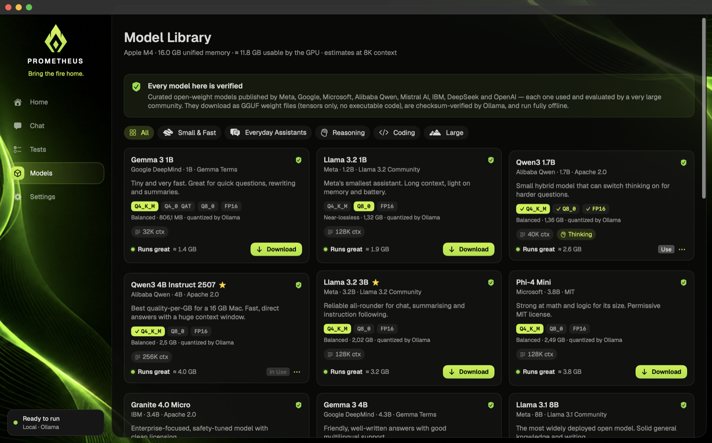

# The harness

**Harness on** means v3, the loop. In the one published run where every version shared a setup it scored highest, level with v4, and it's the simplest of the versions that check a reply and try again. The app runs that one, and there's nothing to choose.

Every other version stays in the code, so the results below can be repeated. One line in Terminal turns a copy into the **lab edition**, which adds **Other versions** to the Harness button in chat, a version to pick in the Harness Test, the Versions tab, Publish on the Tests page, and v1, v2 and v3 in Dev mode:

```sh
defaults write com.localaiagent.app edition lab
```

Quit and open the app again after it. `defaults delete com.localaiagent.app edition` turns it back. Your chats and test runs are the same in both.

| Version | What it does |
| --- | --- |
| **v1 Model tools** | The model gets the tools and decides when to call them. |
| **v2 Pipeline** | The harness works out what the task needs and runs one tool, then the model answers from what it found. Kept exactly as it was. |
| **v3 Loop** | The pipeline, plus code that checks each reply and goes round again until it passes. |
| **v4 Thinking loop** | The loop, with the model thinking through every step it takes part in. Needs Think on: with it off, it works like v3. |
| **v5 Council** | Code prepares a shared notes file, then three agents with their own personality and temperature discuss the task in it, thinking on. |
| **v6 Evidence loop** | New in 2.0, and not scored yet. The loop with stricter evidence: code works out dates, letter counts and sums itself, a looked-up answer only counts when one sentence on the page holds it, and its steps end by saying what was checked. Two rounds at most. |
| **v7 One harness** | New, lab edition only, and not scored yet. It sends each task down one route and switches on only what that route needs: nothing at all, exact code, a program beside the model's own answer, the reply's own code run on the examples in the message, a lookup only when the model isn't sure, a long text's passages, or rule checks. Every route starts from the plain model's reply where it can. |



In the lab edition, the Versions tab puts them side by side, question by question, for runs on the same model and setup.

## Results so far

None of these are held-out results. They come from the app's own questions, which the harness was developed against, and each is a single run. v6 and v7 aren't in them. Held-out results are published in [results](../results/README.md) as they come, whatever they show.

**Max test** (24 questions), scores out of 100, with thinking on, on a MacBook Air M4:

| Model | Context | Off | v1 | v2 | v3 | v4 | v5 |
| --- | --- | --- | --- | --- | --- | --- | --- |
| Qwen3 1.7B Q4_K_M | 4K | 24 | 25 | 42 | not run | not run | not run |
| Qwen3 1.7B FP16 | 8K | 28 | not run | not run | 48 | not run | not run |
| Qwen3 1.7B Q4_K_M | 8K | 24 | not run | not run | not run | 62 | not run |

These are single runs, so don't read much into small differences, and the rows use different setups. They also come from an older version of the test, which gave thinking less room on easy questions and marked a few right answers wrong, so new runs won't compare with them. The v3 run came before a calculator fix that affected one 4-point question. Injection protection stopped 7 of 7 poisoned pages in these runs, against 1 of 7 at most without it.

**Normal test** (9 tasks), scores out of 100, with thinking off, on a Mac mini M4 Pro with 24 GB, from the current version of the test. It's [published in full](../results/mac-mini-m4-pro-24gb-2026-11-07-1228.md), with every reply:

| Model | Context | Off | v1 | v2 | v3 | v4 | v5 |
| --- | --- | --- | --- | --- | --- | --- | --- |
| Qwen2.5 Coder 7B Q8_0 | 16K | 9 | 9 | 47 | 66 | 66 | 47 |

With thinking off, v4 works like v3, so their scores match. In v1 the model wrote its tool calls as plain text instead of making them, then answered anyway: it called element 74 plutonium (it's tungsten). Normal and Max scores don't compare with each other.

## How v3 works

1. **Understand**: works out what kind of task this is.
2. **Act**: runs the right tool. A math or code task runs in the sandbox, a fact is looked up, and a long text is cut down to the passages that matter.
3. **Answer**: the model replies with that evidence in front of it.
4. **Check**: code tests the reply. Was it cut off? Does it state the tool's result? Is the answer in the sources? Does it break a rule such as a word count? If it fails, it goes back to Act with what it learned.

It stops when a reply passes, when a round changes nothing, or at the rounds set in Settings › Safety, and it keeps the best attempt so far. It only ever sees the question, never the expected answer.

## What v4 adds

v3 turns thinking off at almost every step, to save tokens. v4 leaves it on. With Think on, the model reasons before it classifies a task, picks a search, writes a program, answers or rewrites a sentence, and it sees what Check found wrong when it goes round again.

Each step gets extra tokens for this, a quarter of the context up to 2,048. If thinking uses them all, that step goes again without thinking, so a step can't end up with less than it would have had in v3. Check stays code, and anything plain code can settle, such as a simple sum, doesn't call the model at all. It takes longer than v3, and with Think off the two work the same.

## How v5 works

Three agents discuss the task in a Markdown file. They're the same model taking turns, so they use the memory of one and the time of several.

| Agent | Temperature | Personality |
| --- | --- | --- |
| **Solver** | 0.2 | Works step by step and relies on what it can show |
| **Skeptic** | 0.5 | Looks for the flaw and tests answers on a small case |
| **Explorer** | 0.8 | Tries another route and questions what the others assume |

1. **Prepare**: code writes the file, with the task, the chat so far and what the tools found, the same way v3 does.
2. **Round 1**: each agent answers on its own. Nobody sees the others' notes yet, so they don't all copy whoever went first.
3. **Later rounds**: each agent reads the file and answers the others. Code adds what it can check, such as a broken word count or a result the tools disagree with. An agent can only change its answer by giving a reason, because small models tend to copy whoever they read last. Otherwise its old answer stands.
4. **Decide**: after each round, code compares their answers. It stops when all three agree, when nobody changes their answer, or at the rounds set in Settings › Safety. Two out of three is enough at the end.
5. **Reply**: an agent that holds the group's answer writes the reply, and v3's checks test it. A result from the tools outranks anything the agents settled on. On writing tasks, a draft that passes the checks is the reply.

Code does all the reading and writing, so a small model needs no file tools and a bad reply can't damage the file. When the file outgrows the context, an agent is handed the newest rounds that fit. Thinking stays on whatever the Think button says, and an agent that thinks until its tokens run out finishes from where its thinking stopped, so the reasoning isn't lost.

The file builds up under **Shared notes** above the reply, with a button to find it in Finder. It's kept in the app's data folder and goes when you delete the chat.

## Can the models call tools themselves?

Yes. All six Qwen3 models tried so far (1.7B, 4B and 8B, in several quantizations) produce real tool calls, in 34 of 44 prompts in a short check, and all of them used a calculator result correctly. All 10 misses had thinking on and ran out of tokens before making a call, so try v1 with Think off. Being able to call a tool doesn't make the reply right, though: the 1.7B models sometimes search the web for arithmetic, or search for a fact and still get it wrong. That's why v2 onwards don't leave it to the model.

---

[Back to the README](../README.md)
