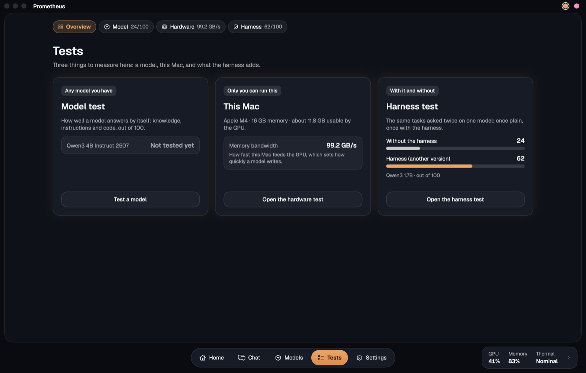
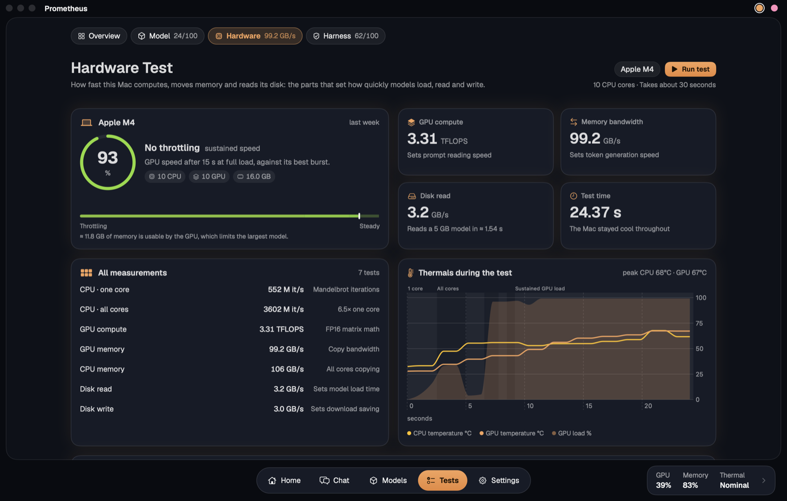

# The tests

The Tests page opens on an overview with one card for each test and its last result. All of them are laid out the same way:

- **Model Test** (⌥⌘3): 24 auto-graded questions across math, reasoning, knowledge, instructions, code and long context. Each topic has four levels worth 1, 2, 4 and 8 points. A score of 100 is the level of Claude Opus 5.5 at max effort, from a blind run of the same questions.
- **Hardware Test** (⌥⌘4, about 30 seconds): CPU, GPU, memory bandwidth and disk speed, plus 15 seconds of sustained GPU load to check for throttling.
- **Harness Test** (⌥⌘5) comes in four sizes, and scores from different sizes don't compare.
  - **Normal** is a quick check: 9 tasks across Coding, Knowledge and Instructions, which show the code sandbox, web search and the rule checks at work.
  - **Max** is the app's full test: the same 24 questions with the harness off and on, then 7 poisoned web pages both ways.
  - **Held-out** asks 120 public questions, from GSM8K, GSM-Plus, IFEval and MBPP, that the harness is never tuned on. Code grades every one, and the app shows totals without showing the questions or replies.
  - **Practice** asks 60 more of the same kinds. That's where failures get studied, so a gain there proves nothing.

  Choose **3 runs** to repeat a test and see every round's score, the mean and the spread. For any two runs on the same questions, the page counts the answers that flipped each way and says how often chance alone would split them that unevenly. **By route** shows, for each kind of task, how many questions went right with the harness and without, and how many flipped each way. Turn off **Harness off too** to run with the harness on only. How the public questions were picked, their licences and what a score on them can't show are in [benchmarks/heldout](../benchmarks/heldout/README.md).

**Publish** (⌥⌘6, in the lab edition, see [The harness](harness.md)) shares your results. Tick the runs you want and press **Publish**. The app saves a JSON file and a readable report named after your Mac and the date, then opens GitHub, where you drag them in to make a pull request. Each task shows its reply, the end of the model's thinking, its token counts, time and points. People's results are in [results](../results/README.md), which also describes the files.

---

[Back to the README](../README.md)
